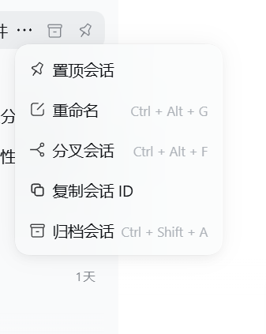

# dsh-session-tools

> DeepSeek Harness（dsh）插件：在侧栏会话行「...」菜单里加一行 **「复制会话 ID」** —— 点一下就把 `session-xxxxxxxx-…` 复制到剪贴板。

会话 ID 是 dsh 里最常用、又最难拿的东西：指认一条会话、给别的 agent 派活、在日志里对号入座，都要它。这个插件把"找到并复制"压成一次点击。



*（截图：会话「...」菜单里的第 4 项「复制会话 ID」；`Ctrl+Alt+G/F` 是宿主自带项，不归本插件管。）*

## 为什么单独做成一个插件

它跟「多 Agent 总线」本来没关系，但最初是塞在别的插件里的。拆出来之后：

- 关掉/改动总线插件，不会连带弄坏这个纯 UI 功能；
- 想用「复制会话 ID」的人，不必附带装一套总线；
- 出问题时一眼能定位到是哪一个插件。

宿主（DSH 本体）**没有**这一项，是插件加的 —— 它只利用宿主公开的槽位契约。

## 安装

### 方式一：本地目录 + profile 链接（开发用，改完刷新即生效）

```jsonc
// <你的 profile>/package.json（如 ~/.dsh/profiles/desktop/package.json）
{
  "dependencies": { "dsh-session-tools": "link:F:\\dsh-plugins\\dsh-session-tools" },
  "dsh": { "profile": { "bundles": ["…", "dsh-session-tools"] } }
}
```

```powershell
# 也可以直接建 junction（等价于 npm link）
cmd /c mklink /J "$env:USERPROFILE\.dsh\profiles\desktop\node_modules\dsh-session-tools" "F:\dsh-plugins\dsh-session-tools"
```

### 方式二：从 GitHub 装（profile 支持 `github:` 依赖）

```jsonc
{ "dependencies": { "dsh-session-tools": "github:SongZcode/dsh-session-tools" } }
```

装完**重启 dsh**（客户端半侧只在 web 启动时装载）。

## 它做什么（就这一件事）

| 项 | 值 |
|---|---|
| 槽位 | `sidebar.workspaces.session.menu.item`（宿主公开槽位） |
| 该项 id | `dsh-session-tools-copy-id` |
| order | `350` —— 宿主自带项占 `100/200/300/400`（置顶/重命名/分叉/归档），350 是它们之间的空档 |
| 行为 | 点击 → `navigator.clipboard.writeText(sessionId)` → 文案变「已复制 ✓」→ 1 秒后复原并派发 Esc 关菜单 |
| 样式 | 先按宿主 `ui-primitives` 的 `Menu.module.css` 原值写死，挂载后再**量一次兄弟菜单项**的实际样式覆盖（dense/compact 变体也能对齐），并继承兄弟项的 class |

三项刻意的设计（都是踩过才定下来的）：

1. **内联样式里不写 `background`** —— 写了会压掉宿主自己的悬浮高亮；悬浮色只放在类规则里，并带回退链
   （`--dsw-alias-interactive-bg-hover` → `--dsw-alias-bg-layer-2` → 半透明灰）。
2. **幂等哨兵**：客户端脚本被重复执行（HMR / 批量 bundle）时，宿主的
   `duplicate factory registration` 会被吸收并只留一条 warn —— 不影响已注册的 factory，也不会让 web 启动失败。
3. **注册 id 必须是 npm 包名**：写成短名会撞宿主已注册的 factory，直接导致 web 启动失败（设置页、联网搜索一起挂）。

## 离线自检（不启动 dsh 也能验）

```powershell
node tools/verify-client.mjs          # 期望 38/38
```

它用一个**假加载器 + 假 react + 假槽位服务**把 `client.js` 真跑一遍，断言：注册 id 对不对、
`inject` 到没到槽位、order 是不是空档、组件渲染会不会抛、ownerProps 两种传参都能取到 sessionId、
以及**同 id 二次注册必须被吸收**（附一条"裸写 load() 会抛 duplicate"的反面对照）。

这条自检是必须的：客户端半侧的锅全在启动期暴露，而修完后重启才发现问题，代价是 dsh 起不来。

## 已知坑位（改之前先读）

| 现象 | 原因 | 做法 |
|---|---|---|
| 包被静默跳过（`skipping profile bundle`） | `package.json` 带了 BOM | 只能写 UTF-8 **无 BOM** |
| web 启动失败，设置页/联网搜索一起挂 | 客户端注册名写成短名 / 同一 bundle 被执行两次 | `__ModuleLoader__.load({ id: "<npm 包名>" })` + 幂等哨兵 |
| 客户端半侧永远加载不到（静默） | `exports["./client"]` 缺失或 `dsh.client` 写错 | 照抄能跑的插件 |
| 整层被跳过、插件不生效 | bundle 没声明 `dsh.bundle`（宿主 `loadProfileDirectory` 会跳过） | 必须有 `cordis.patch.yml` + `dsh.bundle.patch` |
| 菜单项位置不对 | order 撞车 | 先查槽位占用者的 order，挑空档 |
| 改了没反应 | 插件目录同时被 HMR 监听 → 与 loader 叠加重复执行 | **别把插件目录加进 `hmr.root`** |

## 卸载 / 回滚

1. **只关 UI 项**：从 `package.json` 删掉 `"dsh": { "client": … }` 与 `exports["./client"]` → 重启（宿主半侧不受影响）。
2. **关整个插件**：profile 的 `cordis.patch.yml` 里加 `- id: dsh-session-tools` + `disabled: true` → 重启。
3. **删包**：从 profile 的 `bundles`/`dependencies` 移除（本地链接还要删 junction）→ 重启。

## 依赖的宿主私有面（dsh 升级后请复验）

| 私有面 | 在哪 | 坏了的表现 | 怎么办 |
|---|---|---|---|
| 槽位契约 | `sidebar.workspaces.session.menu.item`（ownerProps = `sessionId`/`displayTitle`） | 菜单项不出现，或 web 启动报 entry 未激活 | 用宿主的槽位检查工具重查 ownerProps，改 `client.js` 里的一行 |
| 槽位占位 | 自带项 `pin`=100 / `rename`=200 / `fork`=300 / `archive`=400 | 菜单位置错 | 挑空档改 `order` |
| `react` 由宿主注入 | `require("react")` | 自检报"只允许 require react" | 别引别的包、别自己 bundle react |

## 许可

MIT
